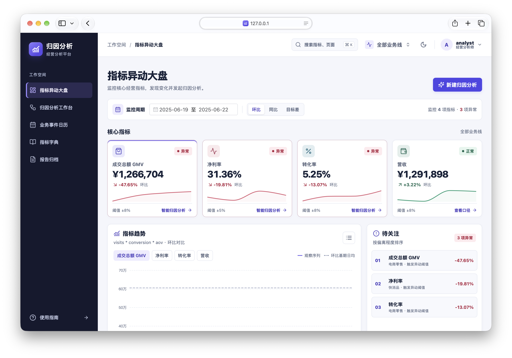

# 经营归因分析系统

从指标异动大盘发现异常，在三栏工作台拆解驱动因子的贡献，通过统计检验和业务事件复核归因假设，再用 What-If 情景对比评估策略并导出报告。



## 交付内容

| PRD 交付项 | 仓库入口 |
| --- | --- |
| 可运行的三栏交互式工作台 | [前端](frontend/README.md)。左栏切换历史会话和查看目标指标，中栏接收自然语言追问并流式展示分析进度，右栏展示贡献瀑布图、指标树、下钻透视表、证据、行动项和 What-If。前端还提供大盘、业务事件日历、指标字典和报告归档。 |
| 后端服务、统计检验与代码沙箱 | [FastAPI 应用](backend/main.py)、[统计沙箱](backend/services/sandbox.py)与[统计执行器](backend/services/sandbox_worker.py)。后端执行 GMV 的 LMDI 分解、净利率的成本率桥接和多维 Shapley 归因。统计验证使用参数化 SQL 和 Python 模板，在无网络、限制资源的容器中读取 DuckDB 只读副本。 |
| 示例多维数仓 | [数据生成器](data/generators/demo.py)与[初始化入口](backend/init.py)。初始化将确定性生成的示例事实数据写入 ClickHouse，并生成沙箱验证副本。 |
| 大促与经营异动仿真 | 电商 618 大促后 GMV 下滑、快消品净利率下降。预置[业务事件](backend/models/catalog.py)和[预期驱动因子](data/expected_attribution.json)。 |
| 多格式报告导出 | [报告渲染器](backend/views/reports.py)。支持在线预览、批注、发布及按章节导出 Markdown、PDF 和 Excel。 |
| 完整分析演示链路 | [双场景操作步骤](#双场景演示)与[真实接口验收](tests/test_live_backend.py)。 |

## 本地启动

需要 Docker（含 Docker Compose）、Python 3.12 或以上版本、uv，以及 Node.js 20.19+（20.x）或 22.12+ 和本地 pnpm。首次启动时，若根目录没有 `.env`，从 [.env.example](.env.example) 复制一份。填写 `LLM_API_KEY` 和 `LLM_MODEL`，后端使用阿里云百炼的 Anthropic Messages 接口调用模型。

在仓库根目录启动数据库、构建统计和 PDF 镜像、初始化数据并运行 API。

```sh
docker compose --env-file .env -f docker/docker-compose.yaml up -d --wait postgres clickhouse
docker compose --env-file .env -f docker/docker-compose.yaml build sandbox report
uv sync --locked
uv run python -m backend.init
uv run uvicorn backend.main:app --host 127.0.0.1 --port 8000
```

初始化可重复执行。PostgreSQL 保存账号、会话、任务、事件和报告，Compose 使用 `postgres:18`，将命名卷 `postgres_data` 挂载到 `/var/lib/postgresql`。API 默认连接 `127.0.0.1:5432/attribution`，可通过 `DATABASE_URL` 覆盖。每个应用 schema 运行一个 API 进程，任务恢复使用 PostgreSQL 会话级锁。

ClickHouse 保存经营事实数据。`ATTRIBUTION_RUNTIME` 指定验证副本和本地签名密钥目录，默认为 `.runtime/`。Docker 需要能挂载其中的 DuckDB 文件。统计验证和 PDF 导出分别通过一次性容器执行，PDF 由 WeasyPrint 和 Noto 中文字体渲染。

打开 [API 健康检查](http://127.0.0.1:8000/api/health)，确认返回 `"data_initialized": true`。可在 [Swagger UI](http://127.0.0.1:8000/docs) 调试接口。

另开终端，在仓库根目录启动前端。

```sh
pnpm --dir frontend install --frozen-lockfile
pnpm --dir frontend dev
```

打开 Vite 输出的地址。前端默认将 `/api` 转发到 `http://127.0.0.1:8000`。双场景演示使用分析师账号登录。

| 账号 | 密码 | 演示权限 |
| --- | --- | --- |
| `analyst` | `analyst-demo-2025` | 在电商和快消品域发起分析、审核证据、模拟情景及发布报告 |
| `manager` | `manager-demo-2025` | 查看电商大盘和已发布报告，订阅简报 |
| `admin` | `admin-demo-2025` | 管理两个指标域及系统配置，查看审计与回放沙箱验证 |

## 示例数仓

`backend.init` 加载 `demo-202506-v1`，并预置指标定义、业务事件和演示账号。经营数据支持日期、渠道、区域、品类和客群五个维度。默认现期为 2025 年 6 月 19–22 日，环比基期为 6 月 15–18 日。也可使用 2024 年同期和同日期的目标数据对比。

| 业务域 | ClickHouse 数据 |
| --- | --- |
| 电商 `ecommerce` | `attribution_fact_orders` 提供访客数、订单数、GMV、断货访客数和促销订单数，并提供流量漏斗与促销视图。 |
| 快消品 `fmcg` | `attribution_fact_cost` 提供销量、营收、原料成本、物流履约费和渠道佣金。 |

## 双场景演示

使用默认日期和环比基期。两套场景各完成一次初始分析和两轮追问，每轮结束后再发送下一条。

| 步骤 | 电商 GMV 下滑 | 快消品净利率下降 |
| --- | --- | --- |
| 发起分析 | 在「电商」大盘找到「成交总额 GMV」，点击「智能归因分析」。 | 切换至「快消品」，进入工作台新建分析并发送「分析快消品净利率异常下降」。 |
| 检查初始结果 | 查看访客数、转化率、客单价的负向贡献，以及「618 大促结束」「美妆高价款断货」两条关联事件。 | 查看原料成本率、佣金费率的负向贡献，以及「饮品原料采购价上涨」「商超渠道佣金调整」两条关联事件。 |
| 第一次追问 | 输入「按渠道下钻，只分析信息流」。 | 输入「按品类下钻，只分析饮品」。 |
| 第二次追问 | 输入「再按品类下钻，保留信息流切片」。确认品类透视表仍限定在信息流。 | 输入「再按渠道下钻，保留饮品切片」。确认渠道透视表仍限定在饮品。 |
| 情景参数 | 访客数分别提高 5% 和 10%。 | 原料成本率分别降低 5% 和 10%。 |

每组案例继续完成以下检查和交付步骤。

1. 在「贡献瀑布图」核对因子贡献之和与指标总差额，在「杜邦拆解树」查看指标公式。展开对话栏候选假设的「查看沙箱代码与执行结果」，核对效应量、p 值、置信度和状态。在「结论与证据」查看异常窗口前后 3 日内的匹配事件及其证据状态。
2. 在「What-If」中按上表调整滑块，每次等待预测更新后保存情景。对比两组点估计、80% 区间和敏感度曲线。在「行动项」查看量化建议及其责任岗位、预计周期和预期挽回金额。
3. 点击「保存快照」和「生成报告」。在报告归档预览异动背景、贡献拆解、下钻明细、核心结论、统计与事件证据、已保存情景及优先行动清单。可添加批注并发布。
4. 在报告归档依次点击「导出 Markdown」「导出 PDF」「导出 Excel」，选择章节后点击「确认导出」。全选章节可导出整篇报告，文件扩展名分别为 `.md`、`.pdf`、`.xlsx`。

## 验收与开发

以下命令在仓库根目录执行。

```sh
uv run pytest -q
ATTRIBUTION_TEST_URL=http://127.0.0.1:8000 ATTRIBUTION_TEST_ARTIFACT_DIR=.runtime/acceptance uv run pytest -q tests/test_live_backend.py
uv run python -m benchmarks.attribution
pnpm --dir frontend test
pnpm --dir frontend build
```

- 后端任务测试需要 PostgreSQL，在独立临时 schema 中验证恢复和重试。基准测试需要 ClickHouse，测量 10 万行聚合及贡献分解耗时。
- 真实接口测试需要已初始化的 API、可调用的模型和已构建的 Docker 镜像。测试会创建两组分析会话和报告，并可通过 `ATTRIBUTION_TEST_ARTIFACT_DIR` 保存三种格式的验收文件。
- 前端浏览器验收使用本地 `agent-browser`，按[双场景演示](#双场景演示)检查三栏、切片继承、证据更新、情景对比和三种导出。构建及离线界面回归配置见[前端说明](frontend/README.md)。

### 项目目录

| 目录 | 职责 |
| --- | --- |
| `backend/models/` | PostgreSQL 表结构、领域模型、指标公式和数仓查询 |
| `backend/controllers/` | FastAPI 路由、权限检查、会话和管理接口 |
| `backend/services/` | 模型调用、归因计算、任务调度、统计沙箱和简报 |
| `backend/views/` | 报告 HTML 预览与 Markdown、PDF、Excel 渲染 |
| `frontend/src/pages/`、`frontend/src/components/` | Vue 页面与交互组件 |

`backend/main.py` 负责组装应用和管理服务生命周期。

项目需求、技术说明、界面设计、接口字段和 SSE 事件见 [PRD](docs/PRD.md)、[技术规格](docs/spec.md)、[UI 设计](docs/ui.md)和[后端接口说明](docs/backend.md)。
